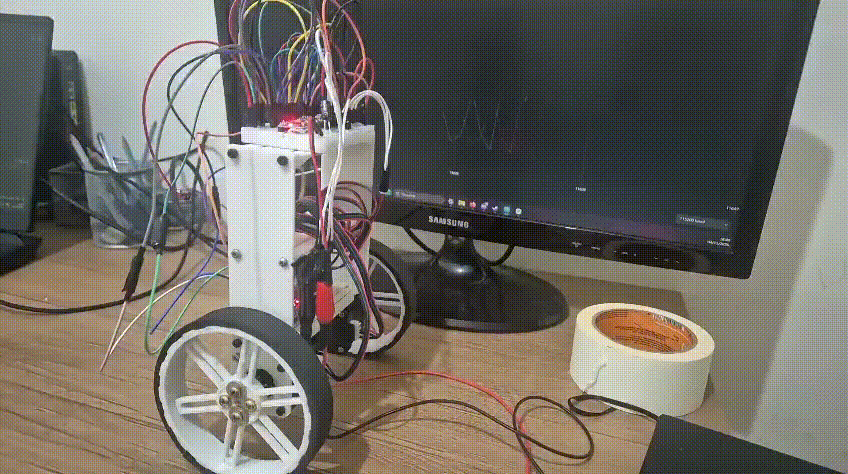
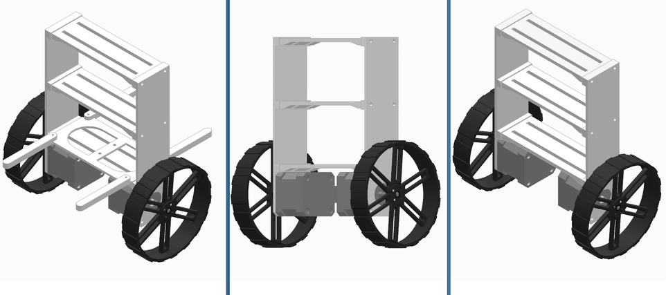
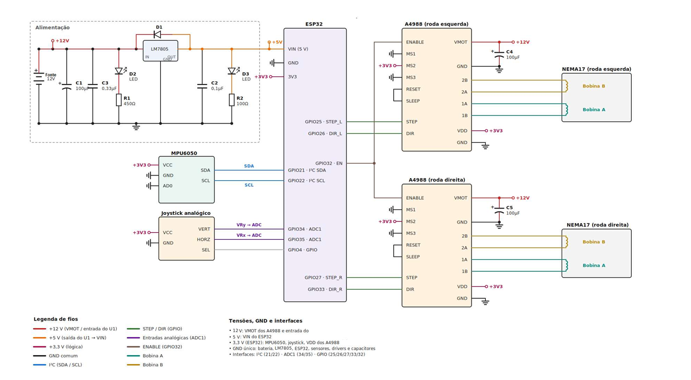

# balanceBot
Projeto das disciplinas SSC0715 - Sensores Inteligentes e SEM0544 - Redes de Comunicação e Sistemas Embarcados

## Introdução

Esse repositório contém os arquivos utilizados na elaboração de um robô de duas rodas autoequilibrante baseado em FreeRTOS.




## Lista de peças

| Peça | Quantidade |
| --- | --- |
| ESP32 | 1 |
| MPU6050 | 1 |
| Motor de passo NEMA 17 | 2 |
| Driver de motor de passo STEP/DIR (`A4988`) | 2 |
| Acoplador para Eixo de 5mm | 2 |
| Borracha de vedação 11mmx6mm |1|
 
## Mecânica

A ideia era fazer com que o chassi fosse modular, de modo que fosse possível imprimir e testar o encaixe das peças sem desperdiçar tempo ou material. Todos os elementos de fixação utilizados para prender os suportes são do tipo M3. A IMU foi fixada no compartimento do topo, para maximizar a leitura das propriedades dinâmicas.

Na imagem da esquerda é possível ver um suporte removível utilizado durante os testes. Ele limita a inclinação do robô, de modo que, em caso de queda, nenhum componente seja danificado.



## Elétrica

A instalação elétrica seguiu o diagrama anexo. O projeto inicial previa um circuito de alimentação próprio (destacado no diagrama como "Alimentação"), com um regulador de tensão LM7805 para gerar os 5 V do ESP32 a partir dos 12 V e capacitores para filtrar a tensão. Esse circuito não foi utilizado na versão final e a alimentação foi feita diretamente por uma fonte de bancada.




## Software

O código completo roda sobre o FreeRTOS com duas tasks:

| Task | Núcleo | Prioridade | Período | Função |
| --- | --- | --- | --- | --- |
| `TaskControl` | 1 | 3 | 5 ms (200 Hz) | Lê o sensor, estima o ângulo, calcula o PD e comanda os motores |
| `TaskTelemetry` | 0 | 1 | 20 ms (50 Hz) | Lê comandos do Serial e imprime a telemetria |

As tasks se comunicam por uma fila de tamanho 1, sempre sobrescrita. A telemetria recebe sempre o dado mais recente, e o controle nunca fica bloqueado aguardando a telemetria.

### IMU (MPU6050)

Optou-se por não utilizar a biblioteca da Adafruit para o MPU6050 devido ao tempo de resposta. Em vez disso, os registradores da IMU são acessados diretamente via I2C, o que reduz o tempo de cada leitura.

A configuração exige a escrita de apenas dois registradores:

- `0x6B = 0x01`: o MPU6050 inicia em modo sleep e retorna leituras zeradas até ser acordado.
- `0x1A = 0x03`: ativa o filtro passa-baixa interno em 42 Hz. Um filtro de 21 Hz atenuava melhor a vibração dos motores, mas introduzia atraso suficiente para anular o efeito do termo derivativo. O valor de 42 Hz é o compromisso entre os dois efeitos.

As demais configurações (giroscópio ±250 °/s, acelerômetro ±2 g) correspondem ao padrão de fábrica. A cada ciclo são lidos 14 bytes a partir do registrador `0x3B`, dos quais são usados três eixos: acelerômetro X e Z e giroscópio Y.

### Filtro complementar

O acelerômetro fornece a direção da gravidade, porém com ruído. O giroscópio fornece um sinal limpo, porém sujeito a deriva quando integrado. O filtro complementar combina os dois:

```
angulo = 0.99 * (angulo + taxa * dt) + 0.01 * angulo_acelerometro
```

Nas variações rápidas prevalece o giroscópio; a longo prazo, o acelerômetro corrige a deriva. O comando `0` calibra o offset do giroscópio (média de 200 leituras com o robô parado) e define a posição atual como ponto de equilíbrio.

### Controle

O equilíbrio é feito por um controlador PD. Para manter um pêndulo invertido em pé, a base precisa acelerar na direção da queda; como o motor de passo é comandado em velocidade, a saída do PD é uma aceleração, que é integrada para obter a velocidade enviada aos motores:

```
aceleracao = Kp * angulo + Kd * taxa_filtrada
velocidade = velocidade + aceleracao * dt
```

Os ganhos podem ser ajustados em tempo real pelo Serial (`kp=...`, `kd=...`), sem regravar a placa.

### Motores

Cada driver A4988 recebe dois sinais do ESP32:

- **STEP:** a cada pulso, o motor avança um passo. A velocidade do motor é definida pela frequência desses pulsos.
- **DIR:** define o sentido de rotação (nível alto para um sentido, nível baixo para o outro).

Os pulsos são gerados por uma interrupção de timer de hardware, e não pelas tasks do FreeRTOS, porque precisam de um espaçamento regular que não dependa do restante do programa. A interrupção é executada em intervalos fixos de 20 µs e, a cada execução, decide se cada motor deve receber um novo pulso. Com isso, a velocidade calculada pelo controle é convertida em uma frequência de pulsos proporcional a ela.

Essa abordagem permite alterar a velocidade a qualquer instante, sem reconfigurar o timer, e um único timer atende os dois motores. Como os motores são montados espelhados no chassi, o sentido de um deles é invertido no software para que ambos girem na mesma direção.

### Segurança

- O controle só é ativado após o comando `go` e com o robô a menos de 5° do ponto de equilíbrio.
- Acima de 35° o robô é considerado caído e os motores são desligados.

## Como usar

1. Gravar `robo_balance.ino` na ESP32.
2. Abrir o Monitor Serial a 115200 baud.
3. Manter o robô em pé e parado, enviar `0` e aguardar a mensagem "Calibracao OK".
4. Enviar `go` e soltar o robô próximo à vertical.

| Comando | Efeito |
| --- | --- |
| `0` | Calibra o giroscópio e define o ponto de equilíbrio |
| `go` | Ativa o controle |
| `stop` | Desativa o controle e os motores |
| `kp=<valor>` | Altera o Kp |
| `kd=<valor>` | Altera o Kd |
